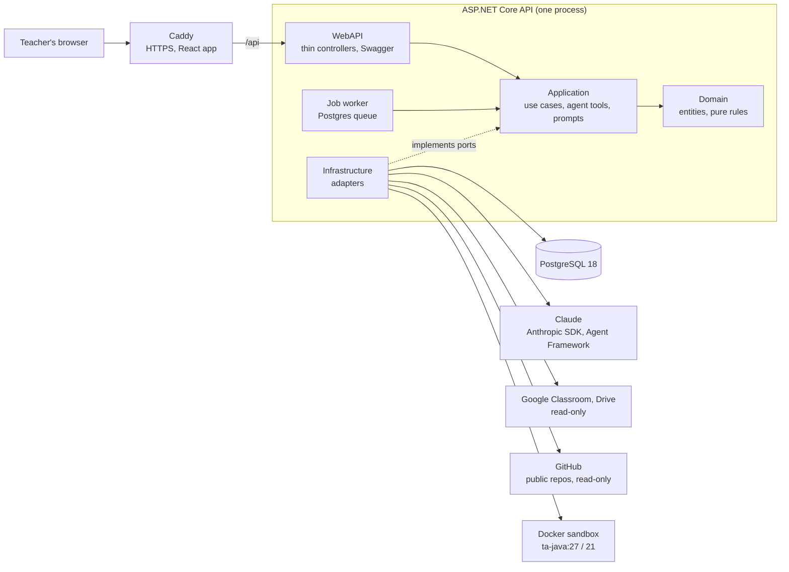
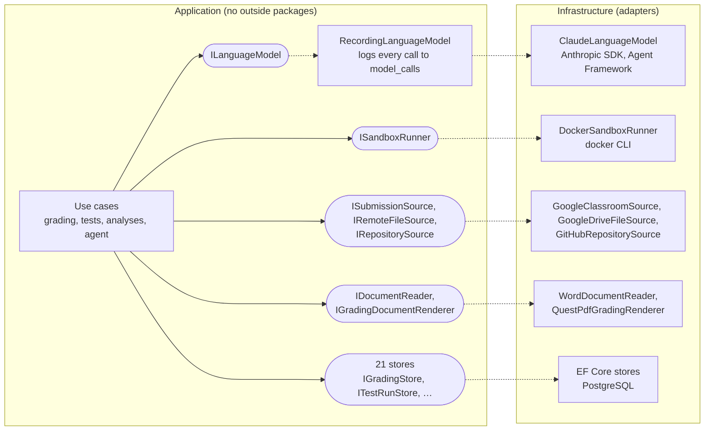

# AI Teaching Assistant — Grading Agent

An AI teaching assistant that grades programming homework. It pulls student submissions from Google Classroom, builds and tests the code in isolated Docker sandboxes, drafts rubric-based scores and feedback with Claude, and leaves every final decision to the teacher.

Built for the **AI Agents Builder Program (HIGGS × KIU)**.

> **Status:** in active development. Working: Google Classroom and GitHub ingestion, the Docker sandbox (compile, javac
> warnings, Checkstyle, PMD), layered rubric grading with Claude, the review dashboard, class and student analyses, PDF
> export, the chat agent, automated tests and the Evaluation page (AI drafts vs. your approved reports). Live at
> https://gradewise.ge (a GCP VM with Docker Compose), deployed by GitHub Actions on every push to `master`.

---

## Why

Grading a programming assignment for a class of up to 8 students per course, across several courses, means downloading every submission, reading and running the code, checking it against a rubric, and writing personal feedback for each student — then doing it again when students resubmit their fixes. It takes hours every week, and consistency suffers by the last submission.

This project automates the drafting, not the deciding:

- **The agent drafts** scores, mistakes and feedback.
- **The teacher reviews, edits and approves** every grade.
- **Grades never leave the tool** — the app has read-only access to Classroom and cannot publish anything.

## Features

One line per area; [docs/FEATURES.md](docs/FEATURES.md) has the full detail of each (what it does, how, and what is planned).

| Area | What it does | Status |
|---|---|---|
| **Classroom ingestion** | Connects the teacher's Google account read-only and fetches turned-in work and the assignment's instructions as versioned snapshots | ✅ |
| **Submission formats** | Drive files, zip/rar/7z/tar archives, documents, images and public GitHub repository links | ✅ |
| **Sandboxed checks** | Compiles student code in a locked-down Docker container (JDK 27, 21 as fallback) with javac warnings, Checkstyle and PMD before any AI judgment | ✅ |
| **Rubric grading** | Claude grades against layered rubrics (course guidance, policy rules, assignment notes): structured score, mistakes and strengths first, feedback in a separate pass | ✅ |
| **Automated tests** | Test cases generated from the instructions, approved by the teacher, connected to each student's own class names by an adapter, run in the sandbox and given to the grader as evidence | ✅ |
| **Background jobs** | Gradings, analyses, test runs and agent runs run in a Postgres job queue with retries, deduplication and recovery | ✅ |
| **Review dashboard** | Monaco code viewer with mistakes and strengths marked on their lines; the teacher edits and approves every report | ✅ |
| **Resubmissions** | A changed submission becomes a new version and is graded again; earlier drafts stay in the history | ✅ |
| **Common mistakes** | Groups the class's mistakes for one assignment and suggests what to cover in the next lecture | ✅ |
| **Students and grades** | Roster, every student's state and grade per assignment, a gradebook per course | ✅ |
| **Student profiles** | Each student's mistake history (new vs. repeated), strengths and an AI overview over time | ✅ |
| **Agent chat** | An "Ask agent" panel on every page: a Microsoft Agent Framework agent with tools that fetches, grades, runs tests, analyzes and exports PDFs, and waits for background work | ✅ |
| **PDF reports** | A styled report of one grading for the student | ✅ |
| **Evaluation** | How often the AI's drafts agree with the teacher's approved reports, per model | ✅ |
| **Teacher UI** | React dashboard with workspace pages, a Ctrl+K palette and a review queue across courses | ✅ |

## Architecture

A monolith with onion layering: one ASP.NET Core process serves the API and runs the background job worker; the React app is a thin client over it.



**Layer rules**, checked in review and by the build:

- Dependencies point inward: WebAPI → Application → Domain; Infrastructure implements Application's ports. WebAPI references Infrastructure only to register it.
- Domain and Application use no outside packages (no Anthropic, EF Core, Google or Docker), so the grading logic is tested with plain fakes.
- Every model call goes through one port, `ILanguageModel`, and every sandbox run through `ISandboxRunner`; only Infrastructure talks to the Anthropic SDK or starts `docker`.
- Contract first: controllers return Application contracts, Swagger describes them, and the frontend's TypeScript types are generated from that spec.

**How one submission is graded:**

1. **Fetch.** The Classroom adapter downloads the turned-in files (or the linked GitHub repository) read-only and stores them as a new version when they changed.
2. **Queue.** "Grade with AI" (or the agent) queues a job and returns `202` at once; the worker picks it up.
3. **Check.** The code is compiled in a throwaway container with no network, a read-only file system and memory, CPU and process limits; compiler warnings and static analysis are collected.
4. **Test.** When the assignment has an approved test set, the student's adapter is written or reused and the tests run in the sandbox.
5. **Grade.** Claude gets the instructions, the rubric layers, the check and test results and the code (never the student's name) and returns a structured score, mistakes and strengths bound to C# records; feedback is written in a second pass.
6. **Review.** The draft appears in the dashboard; the teacher edits and approves it. Only then are the mistakes added to the student's profile.

**Ports and adapters.** Application defines what it needs as interfaces (ports); Infrastructure provides the implementations (adapters). Swapping Claude for another or a local model, or Docker for another sandbox, means writing one new adapter, with no change to the grading logic or its tests.



The full database schema, with one diagram of all tables and one per area, is in [docs/DATA-MODEL.md](docs/DATA-MODEL.md).

## Tech stack

| Layer | Technology | Why |
|---|---|---|
| **Backend** | ASP.NET Core Web API on **.NET 10**, onion architecture | A typed, fast server stack the teacher maintains; the layers keep grading logic free of SDKs and testable |
| **AI** | **Anthropic Claude** via the official Anthropic C# SDK; agents with tools run on **Microsoft Agent Framework** (`Microsoft.Agents.AI`) over the SDK's `IChatClient`, in Infrastructure only | Claude for code-heavy grading with structured output; Agent Framework gives tools and multi-step runs without hand-written loops |
| **Database** | **PostgreSQL 18** in Docker (pgvector installed, not used yet), **EF Core 10** with migrations | Relational data (versions, gradings, mistakes) with JSON columns where shapes vary; pgvector ready for similar-mistake search |
| **Integrations** | **Google Classroom API** and **Google Drive API** (read-only scopes), Google OAuth 2.0; **GitHub REST API** (public repositories, read-only, optional token) | Where the teacher's classes already live; read-only scopes guarantee grades never leave the tool |
| **Sandbox** | **Docker**: a throwaway, locked-down container per check from `ta-java:27` (Temurin JDK 27 with Checkstyle, PMD and SpotBugs; `ta-java:21` as an optional fallback), driven by the `docker` command line | Student code is untrusted: a throwaway container with no network and hard limits is the only place it runs |
| **API docs** | **Swashbuckle** (Swagger UI) with XML documentation | The OpenAPI spec is generated from the code and drives the frontend types, so the contract cannot drift |
| **Documents** | **QuestPDF** (Community licence) for the PDF grading reports, **Markdig** to render the review's Markdown in them | PDF reports generated in code, no headless browser needed |
| **Logging** | **Serilog** (structured logging) | Structured logs of jobs, model calls and sandbox runs |
| **Frontend** | **React 19** + Vite + TypeScript, Tailwind CSS, TanStack Query, React Router, Recharts (charts), lucide-react (icons), fonts bundled with the app through Fontsource (FiraGO with Noto Sans Georgian for Georgian text, Zilla Slab, JetBrains Mono; nothing is loaded from a CDN); API types generated from the Swagger spec (`openapi-typescript`) | A thin client: TanStack Query caches the API, generated types keep it in step with the backend |
| **Tests** | **xUnit v3** on Microsoft Testing Platform | Fast tests on fakes, so no test ever makes a paid model call |
| **Deployment** | **Docker Compose** on a GCP VM, **Caddy** (HTTPS with Let's Encrypt), **GitHub Actions** with images in GitHub's registry (ghcr.io) | One small VM is enough for one teacher; every push is tested, built once and deployed as the exact images that passed |

## Project structure

```
TeachingAssistant.WebAPI.sln
global.json                              test runner configuration (Microsoft Testing Platform)
.editorconfig                            C# code-style rules (e.g. braces on every if/for), checked by the IDE and the build
Directory.Build.props                    settings for every project (code-style checks during dotnet build)
dotnet-tools.json                        local tools (dotnet-ef)
docker-compose.yml                       local Postgres
docs/PRODUCT.md                          product spec: the problem, scope, planned features, UI screens, evaluation, deployment plan
docs/FEATURES.md                         every feature area in full detail (the README has one line each)
docs/API.md                              every endpoint with a one-line description (Swagger is the source of truth)
docs/DATA-MODEL.md                       the database schema: one ER diagram of all tables and one per area
sandbox/                                 Docker images student code runs in (java/Dockerfile: JDK + Checkstyle, PMD, SpotBugs)
src/
  TeachingAssistant.Domain/
    Sandbox/                             which Java files compile together (one program per package root)
    Ingestion/                           submissions, versions (snapshots), content, change detection, course assignments
    Grading/                             grade history and the Classroom grade rule (the latest returned grade), mistake enums
    Profiling/                           students, enrollments, overall score rule
    Jobs/                                background jobs (queued work such as grading and fetching) and their life cycle
    Agents/                              stored agent chats: conversation, its messages, and one run per teacher message
  TeachingAssistant.Application/
    Contracts/                           what the API returns and accepts: one folder per controller, one type per file,
                                         one flat namespace (contract names are unique, as Swagger needs)
    Interfaces/                          ports (ILanguageModel, ISubmissionSource)
    Interfaces/Services/                 use-case interfaces
    Services/                            use-case implementations
    Checks/                              the short Checkstyle and PMD rule lists the sandbox runs on student code
    Prompts/                             the model's fixed instructions as Markdown files (agent, grading, class and student
                                         analyses), embedded in the assembly and read once by PromptLibrary
    Exceptions/                          application-level errors
  TeachingAssistant.Infrastructure/
    LanguageModel/                       Claude adapter
    Google/                              OAuth, Classroom adapter, Drive adapter (file metadata and download)
    Persistence/                         EF Core DbContext, entity mappings, migrations, submission/student/assignment stores
    Storage/                             submission files on disk (versions written atomically), code extraction
    Documents/                           reads Word .docx files (instructions, reports) for the model: text plus embedded pictures
    Sandbox/                             runs student code in a locked-down Docker container (DockerSandboxRunner)
  TeachingAssistant.WebAPI/
    Controllers/                         HTTP endpoints
    Extensions/                          service registration
    ExceptionHandling/                   exceptions → ProblemDetails responses
tests/
  TeachingAssistant.Tests/               xUnit tests for Domain and Application
frontend/                                React app (Vite)
  src/api/                               generated API types (schema.d.ts), client, one hook per endpoint
  src/components/                        layout (top bar, course sidebar, jump palette) and shared UI pieces (ui.tsx)
  src/index.css                          design tokens (colours, fonts, shadows, motion) and the few global styles
  src/theme.ts                           colours for charts, code marks and avatars, kept in step with index.css
  src/navigation.ts                      the course and workspace sections with their icons (navigation and routes read it)
  src/pages/                             Home, Course overview, Assignments, Assignment (list + board), Instructions, Students, AI drafts, Gradebook, Common mistakes, Review queue, System, Settings, planned sections
deploy/                                  deployment on one VM: docker-compose.yml (Caddy, API, one-off migration, Postgres),
                                         the API image, the frontend image (built React app served by Caddy) and the Caddyfile
.github/workflows/ci.yml                 CI/CD: tests and frontend build on every push, then images to ghcr.io and a deploy to the VM
```

## Getting started

### Prerequisites

- [.NET 10 SDK](https://dotnet.microsoft.com/download)
- [Docker](https://www.docker.com/products/docker-desktop/) (for Postgres and the code sandbox)
- An [Anthropic API key](https://console.anthropic.com/)
- A Google Cloud project with an OAuth client (for Classroom access — see below)

### 1. Clone and build

```bash
git clone <repository-url>
cd Teaching-assistant
dotnet tool restore
dotnet build
```

### 2. Configure secrets

Secrets are stored with [.NET user-secrets](https://learn.microsoft.com/aspnet/core/security/app-secrets) — never in source control or `appsettings.json`.

```bash
dotnet user-secrets set "Anthropic:ApiKey" "YOUR_ANTHROPIC_KEY" --project src/TeachingAssistant.WebAPI
dotnet user-secrets set "Google:ClientId" "YOUR_CLIENT_ID" --project src/TeachingAssistant.WebAPI
dotnet user-secrets set "Google:ClientSecret" "YOUR_CLIENT_SECRET" --project src/TeachingAssistant.WebAPI
```

Optional: a GitHub token raises GitHub's limit from about 60 to 5,000 requests an hour (each GitHub submission takes about two). Create a fine-grained personal access token with *Public repositories (read-only)* access and no other permissions, then:

```bash
dotnet user-secrets set "GitHub:Token" "YOUR_GITHUB_TOKEN" --project src/TeachingAssistant.WebAPI
```

The Anthropic key can alternatively be provided through the `ANTHROPIC_API_KEY` environment variable.

### 3. Start the database

Copy `.env.example` to `.env` (git-ignored) and choose a local password, then start Postgres and point the API at it:

```bash
docker compose up -d
dotnet user-secrets set "ConnectionStrings:Postgres" "Host=localhost;Port=5432;Database=teaching_assistant;Username=teaching_assistant;Password=YOUR_LOCAL_PASSWORD" --project src/TeachingAssistant.WebAPI
```

Build the sandbox image the compile and style checks run in (once, and again after changing `sandbox/java/Dockerfile`; see `sandbox/README.md`):

```bash
docker build -t ta-java:27 sandbox/java
```

Without it, or with Docker stopped, grading still works and each draft says the code was not compiled.

In Development the API creates the database and applies pending migrations when it starts, so there is no separate step. Outside Development, apply them deliberately: either with `dotnet ef database update --project src/TeachingAssistant.Infrastructure --startup-project src/TeachingAssistant.WebAPI`, or by starting the published API once with `--migrate` (`dotnet TeachingAssistant.WebAPI.dll --migrate`), which applies pending migrations and exits without starting the web server or the job worker. Behind a reverse proxy (Caddy on the deployed VM) the API reads the forwarded headers, so it must not be reachable except through the proxy.

Data lives in a Docker volume, outside the repository. Submission files are stored under `%LOCALAPPDATA%\TeachingAssistant` (configurable as `Storage:Root`), outside the repository and outside synced folders such as OneDrive, as `submissions\{course}\{assignment}\{student} ({id})\v{n}\` with `original\` (exactly as submitted) and `code\` (archives unpacked, IDE folders and compiled files left out). Assignment instructions are stored next to them as `instructions\{course}\{assignment} ({id})\v{n}\original\`. After changing the entity model, add a migration with `dotnet ef migrations add <Name> --project src/TeachingAssistant.Infrastructure --startup-project src/TeachingAssistant.WebAPI --output-dir Persistence/Migrations`.

### 4. Set up Google Classroom access

1. Create a project in the [Google Cloud Console](https://console.cloud.google.com/).
2. Enable the **Google Classroom API** and the **Google Drive API**.
3. Configure the OAuth consent screen: audience **External**, publishing status **Testing**, and add your Google account as a test user.
4. Create an OAuth client ID of type **Web application** with the authorized redirect URI `http://localhost:5173/api/auth/google/callback`, and store its ID and secret as shown above. The redirect URI is the `Google:RedirectUri` setting (set for Development in `appsettings.Development.json`); a deployed copy registers its own address (`https://<host>/api/auth/google/callback`) on the same client and sets `Google:RedirectUri` to it.

The token Google returns is stored as a file in the folder named by `Google:TokenStoreFolder` (a relative name is placed under the user's application data folder; an absolute path, such as a mounted volume, is used as it is).

> In Testing mode, Google refresh tokens expire after about 7 days. Reconnect from the **Settings** page when the status shows `ReconnectRequired`.

### 5. Run

```bash
dotnet run --project src/TeachingAssistant.WebAPI --launch-profile https
```

Swagger UI opens at `https://localhost:7107/swagger`. To connect Classroom, open **Settings** in the frontend and click **Connect**: the browser goes to Google's consent page and comes back to Settings once access is granted.

### 6. Run the frontend

Requires [Node.js](https://nodejs.org) (LTS). With the API running on `http://localhost:5288`:

```bash
cd frontend
npm install
npm run dev
```

Open `http://localhost:5173`. The Vite dev server forwards `/api/*` to the API, so no CORS setup is needed. After changing API contracts, regenerate the TypeScript types with `npm run gen:api` (the API must be running). To point the dev server at an API on another port, set `API_URL` (e.g. `API_URL=http://localhost:5299`).

## Deployment

The app is deployed on one Linux VM with Docker Compose; everything is in `deploy/`:

| Service | Image | Role |
|---|---|---|
| `caddy` | `deploy/frontend.Dockerfile` | The only public service (ports 80 and 443). Gets the HTTPS certificate for the domain, serves the built React app (falling back to `index.html` for its routes) and passes `/api/*` to the API with the prefix stripped, as Vite does locally. |
| `app` | `deploy/api.Dockerfile` | The API on port 8080, reachable only from Caddy. Runs as a non-root user; gets the VM's Docker socket to start sandboxes, and keeps submission files and the Google token on the `app-data` volume. |
| `migrate` | same as `app` | Runs once before `app` with `--migrate`: applies pending migrations and exits. |
| `postgres` | `pgvector/pgvector:pg18` | The database, on the `postgres-data` volume, not published. |

Before the first start:

1. A VM with Docker (about 2 vCPU and 4 GB of memory) and a domain pointing at its IP address. Google accepts only HTTPS redirect addresses outside localhost, and Caddy needs the domain for the certificate.
2. On the Web application OAuth client, add `https://<domain>/api/auth/google/callback` as an authorized redirect URI.
3. On the VM, build the sandbox images, which the API starts through the VM's Docker: `docker build -t ta-java:27 sandbox/java` and `docker build -t ta-java:21 --build-arg JDK_VERSION=21 sandbox/java`.
4. Copy `deploy/.env.example` to `deploy/.env` and fill it in (domain, the docker group id, Postgres password, Anthropic key, Google client ID and secret, optional GitHub token).

Then, from `deploy/`:

```bash
docker compose up -d --build
```

Open `https://<domain>`, go to **Settings** and connect Google. Updates then come from continuous deployment (below); to build on the VM instead, pull the new code and run the same command again; to stop, `docker compose stop`. The deployed copy runs in Production: no Swagger, no automatic migrations on start (the `migrate` service does that), and the configuration comes only from `deploy/.env`.

### Continuous deployment

`.github/workflows/ci.yml` runs on every push and pull request to `master`:

| Job | What it does |
|---|---|
| Backend tests | `dotnet test` on Ubuntu, after building `ta-java:27`, so the Docker sandbox tests run instead of being skipped. No test calls a paid model. |
| Frontend build | `npm ci`, then the type check and production build. |
| Build and push images | Push to `master` only, after both checks pass: builds `deploy/api.Dockerfile` and `deploy/frontend.Dockerfile` and pushes them to GitHub's registry as `ghcr.io/<owner>/teaching-assistant-api` and `-frontend`, tagged `latest` and with the commit. |
| Deploy to the VM | Over SSH: fast-forwards the VM's checkout to the commit, rebuilds the sandbox images (cached, so quick when `sandbox/` did not change), logs in to the registry with the run's short-lived token, pulls the images tagged with the commit, runs `docker compose up -d` (the `migrate` service applies new migrations first) and logs out. |

One-time setup:

1. **A deploy key.** Create a key pair used only for this (`ssh-keygen -t ed25519 -f deploy_key -N ""`), add the public key to the VM user that owns the checkout (Compute Engine → the VM → Edit → SSH keys, or that user's `~/.ssh/authorized_keys`); that user must be in the `docker` group.
2. **Repository secrets** (GitHub → Settings → Secrets and variables → Actions): `VM_SSH_KEY` (the private key), `VM_HOST` (the VM's IP address), `VM_USER` (that user) and, optionally, `VM_HOST_KEY` (the VM's `ssh-ed25519 AAAA…` host key from `/etc/ssh/ssh_host_ed25519_key.pub`, so the job does not trust the first key it sees). If the checkout is not at `~/Teaching-Assistant`, set the variable `VM_APP_DIR`.
3. **An environment** named `production` (Settings → Environments). The deploy job runs in it, so a required reviewer can be added there to approve each deploy.

The deploy job fails when the VM is stopped; start it and use **Re-run jobs**, or run the workflow by hand (**Run workflow**). The VM needs only outbound access to GitHub; secrets stay in `deploy/.env` on the VM and never pass through CI.

## API

The API is contract first: every endpoint is documented in its controller's XML comments, which flow into the OpenAPI document. Run the API locally and open **Swagger UI at `/swagger`** (the spec is at `/swagger/v1/swagger.json`); the deployed copy runs in Production without Swagger. Errors are returned as [RFC 9457 Problem Details](https://www.rfc-editor.org/rfc/rfc9457). [docs/API.md](docs/API.md) lists every endpoint with a one-line description.

| Area | Routes | Covers |
|---|---|---|
| Health | `/health`, `/health/model` | Liveness; a test prompt to Claude (paid) |
| Google | `/auth/google/*` | Connect, status, callback and disconnect of the read-only Google account |
| Courses and students | `/courses`, `/courses/{id}/students`, `/courses/{id}/gradebook` | Courses, roster sync, student pages, mistake records, analyses, gradebook |
| Assignments | `/courses/{id}/assignments/…` | Assignments, instructions, submissions and fetching, assignment notes |
| Grading | `/versions/{id}/…`, `/gradings/…`, `…/grade-all`, `/stored-files` | Grade a version or a whole assignment or student, drafts, reports (review and approve), PDF export, stored files |
| Rubric and policy | `/grading-principles`, `/policy-rules`, `/courses/{id}/grading-guidance` | The teacher's rubric layers |
| Automated tests | `/courses/{id}/assignments/{id}/tests/…` | Generate, edit and approve test cases, test code, test runs and results |
| Analyses | `…/common-mistakes`, `/mistake-clusters/…`, `/review-queue` | Common mistakes per assignment, the review queue across courses |
| Jobs | `/jobs/…` | Background job status, progress, cancel and retry |
| Agent | `/agent/…` | Background agent runs and stored conversations |
| Evaluation and usage | `/evaluation/…`, `/model-usage`, `/grading-models` | AI drafts vs. approved reports, evaluation runs, model calls and cost |

## Prompts

The model's fixed instructions are Markdown files in `src/TeachingAssistant.Application/Prompts/`, one per job:

| File | Used by |
|---|---|
| `agent.md` | the Ask agent chat (the open page is added after it in code) |
| `grading.md` | grading one submission; `{{rubric}}` is replaced by the teacher's layers from the Rubric & policy page |
| `class-mistakes.md` | the Common mistakes analysis of an assignment |
| `student-mistakes.md`, `student-strengths.md`, `student-overview.md` | the three AI analyses on a student's pages |
| `tests.md` | writing an assignment's test cases (requirements, cases and the neutral interface) from its instructions |
| `test-code.md` | writing the JUnit test class from the approved cases |
| `test-adapter.md` | writing one student's adapter, which connects their classes to the test interface |

Edit the wording there and restart the API. The files are embedded in the Application assembly and read once into memory
(`PromptLibrary`), with line endings normalized so every machine sends the same bytes; a `{{placeholder}}` left unfilled
throws instead of reaching the model. What changes per call stays in code: the teacher's rubric layers (stored in the
database and edited in the UI), the student's code and records, the JSON output schemas (they must match the C# records
that parse the answer) and the tool descriptions (on each `[AgentTool]` method).

## Testing

```bash
dotnet test --project tests/TeachingAssistant.Tests
```

The tests run on Microsoft Testing Platform (set in `global.json`), whose `dotnet test` needs `--project`. To run one
class, add `--filter-class "*GradesTests"` (`--filter-method` and `--filter-namespace` work too).

Tests focus on Application use cases and Domain rules, using hand-written fakes for ports such as `ILanguageModel`.
The sandbox runner's tests use the real Docker and the `ta-java:27` image (see `sandbox/README.md`); they are skipped
when Docker is not running or the image is not built. CI runs the whole suite on every push, with the image built (see Continuous deployment).

## Security and privacy

- **Read-only by design.** The app requests only read-only Google scopes (`classroom.courses.readonly`, `classroom.coursework.students.readonly`, `classroom.rosters.readonly`, `classroom.profile.photos`, `drive.readonly`). Google itself rejects any write attempt, so grades can never be published by the tool. Grades are only *read* from Classroom (with their history) and kept in the local database. GitHub is read the same way: only public repositories, through a token limited to read-only access to public repositories (or no token at all), so the tool cannot change a student's repository.
- **Teacher in control.** The AI produces drafts only; nothing is final until the teacher approves it.
- **Student code is isolated.** Submissions run only inside Docker sandboxes, never on the host.
- **Privacy.** Real student data is approved for the MVP and Demo Day. The model receives only what grading needs (instructions, code and the student's files), never names, emails or photos. Photos are stored locally and served by the app itself. For later scale: a local model or anonymization before anything reaches an LLM.
- **The deployed copy has no login.** Anyone who opens its address sees the data and can start gradings, which cost money; the VM is meant to run only during the test stage. Only Caddy is published; the API trusts the forwarded headers Caddy sends, so it must never be reachable directly.
- **Secrets stay local.** API keys and OAuth client secrets live in user-secrets or environment variables; OAuth tokens are stored outside the repository.
- **Student work stays on the machine.** Fetched submissions are stored in a local folder outside the repository and outside cloud-synced folders.

## Author

Built by Luka Khachapuridze as a solo project for the AI Agents Builder Program (HIGGS × KIU), 2026.
