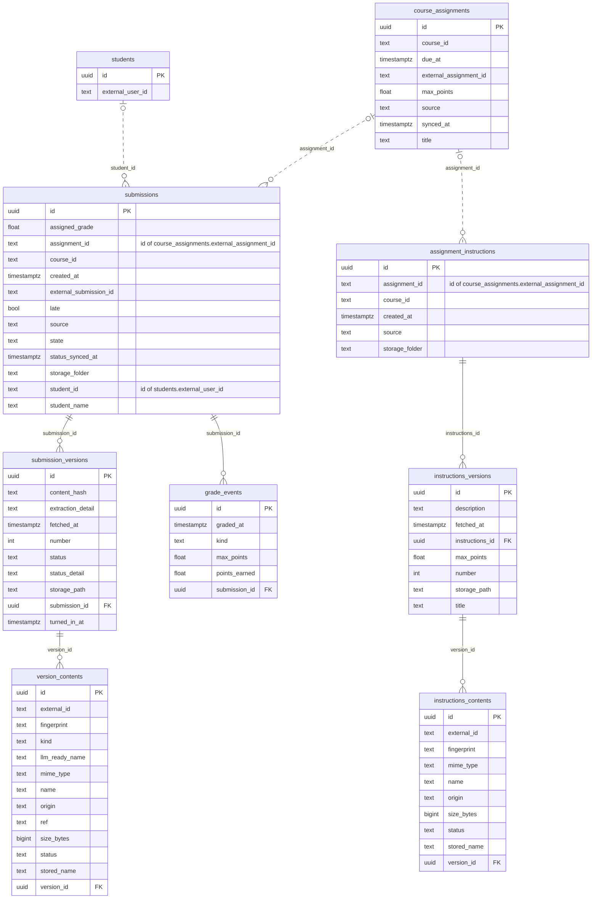
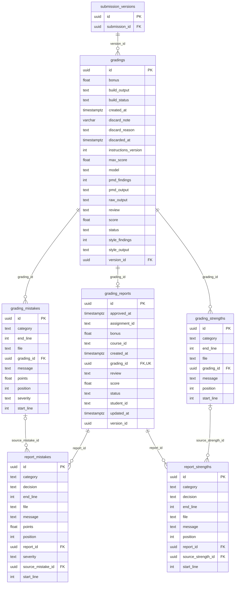
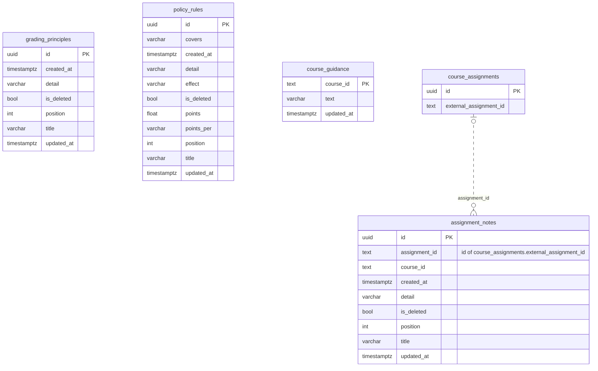
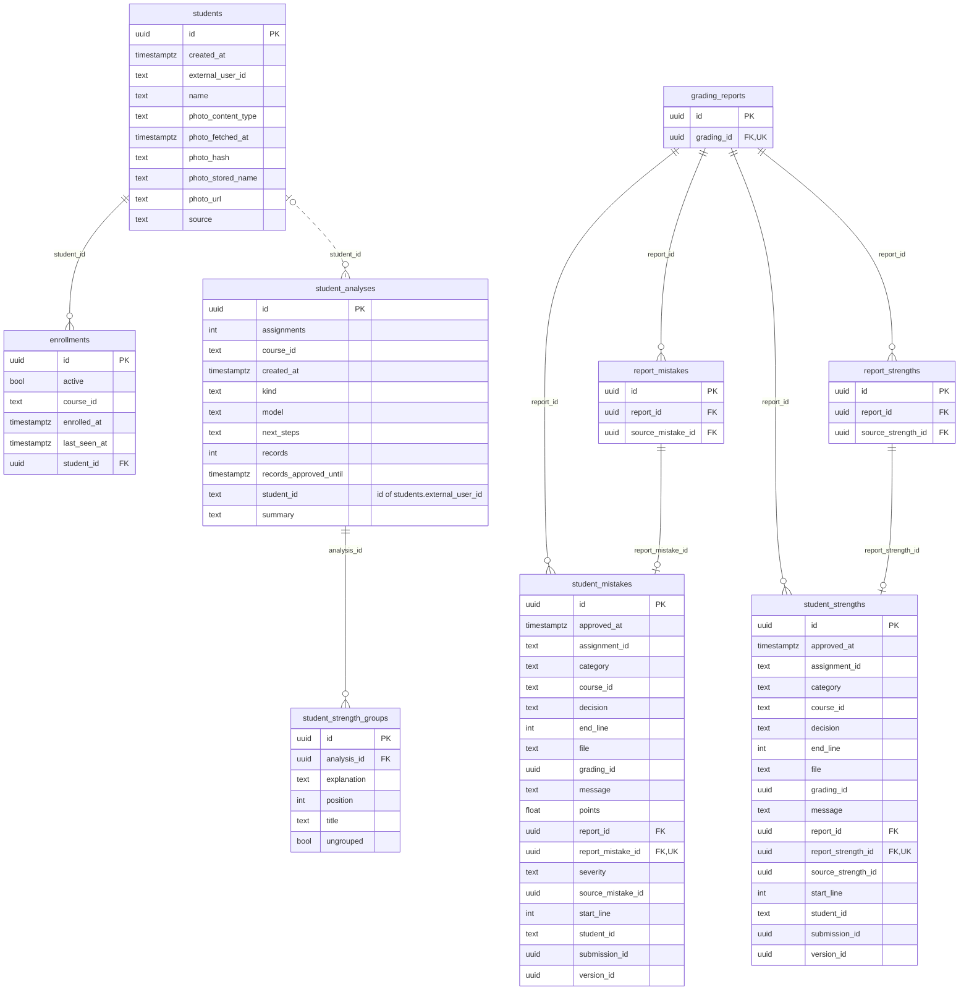
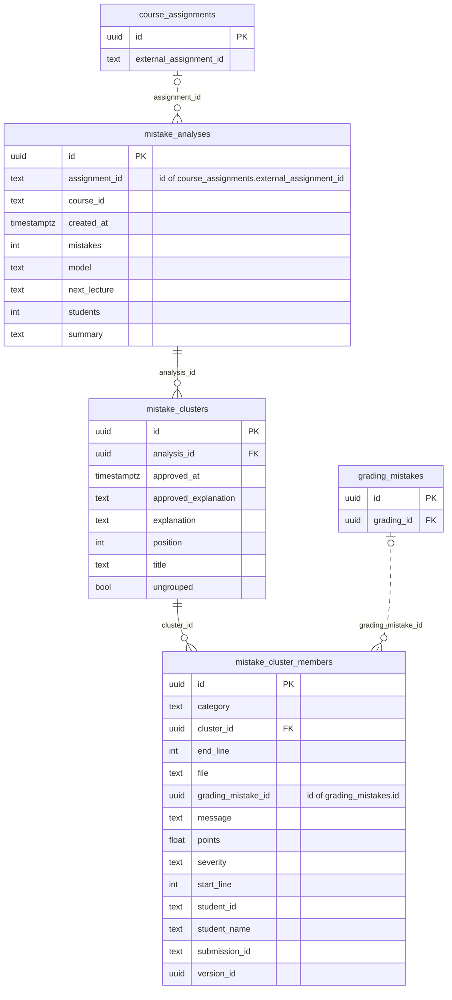
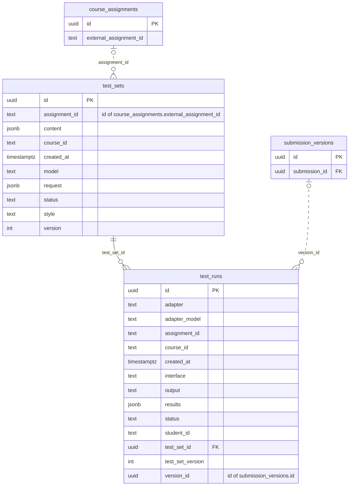
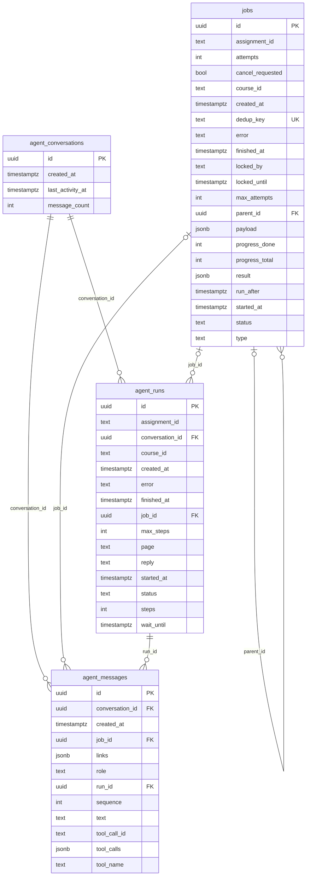
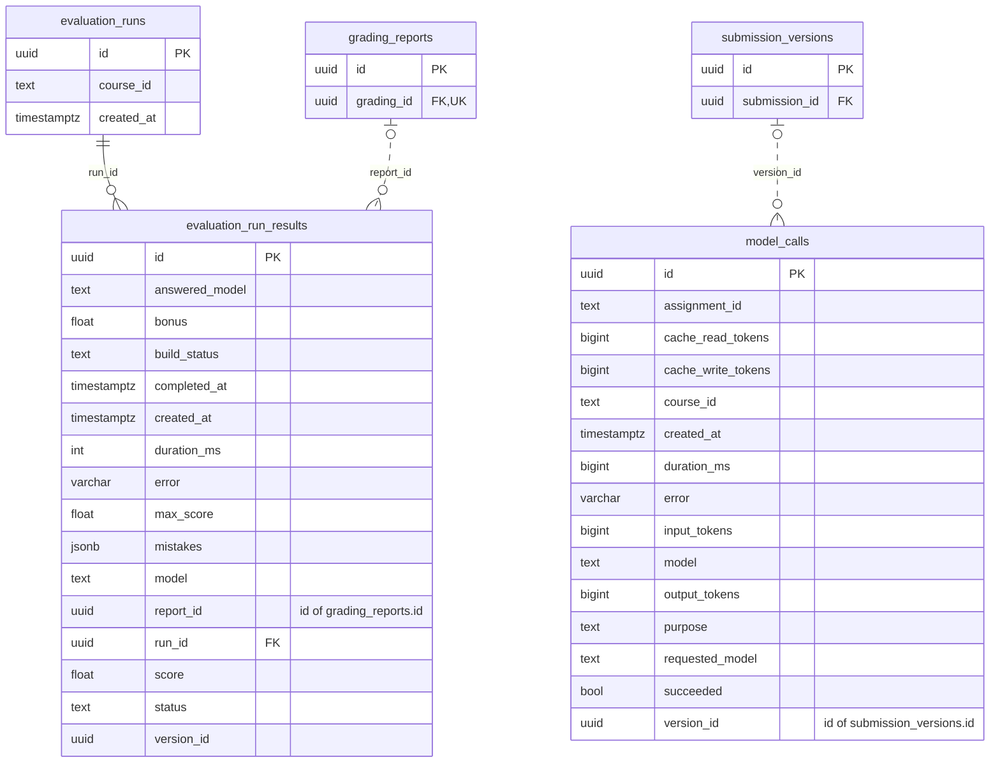

# Data model

The PostgreSQL schema behind the app: 36 tables, managed by EF Core 10 migrations in `src/TeachingAssistant.Infrastructure/Persistence/` (one configuration class per table in `Configurations/`). The diagrams are generated from the migrations' model snapshot, so names and keys match the database.

How to read them:

- **Solid lines** are foreign keys enforced by the database; **dashed lines** are references by id that the code keeps without a constraint, mostly the Google Classroom ids (`course_id`, `assignment_id`, `student_id` are Classroom's own ids, stored as text).
- `PK` primary key, `FK` foreign key, `UK` unique. Courses have no table: the course list comes live from Google Classroom, and tables keep its `course_id`.
- Columns typed `jsonb` hold structures that are read and written whole (job payloads, test set contents, agent tool calls).

## The whole model

Every table and how they connect; each line is labelled with the column that holds the reference. The sections below show each area with all its columns.

```mermaid
erDiagram
    agent_conversations
    agent_messages
    agent_runs
    gradings
    assignment_notes
    mistake_cluster_members
    course_guidance
    evaluation_runs
    evaluation_run_results
    grade_events
    grading_mistakes
    grading_principles
    grading_reports
    grading_strengths
    mistake_analyses
    mistake_clusters
    policy_rules
    report_mistakes
    report_strengths
    assignment_instructions
    course_assignments
    instructions_contents
    instructions_versions
    submissions
    submission_versions
    version_contents
    jobs
    enrollments
    student_strength_groups
    students
    student_analyses
    student_mistakes
    student_strengths
    test_runs
    test_sets
    model_calls
    agent_conversations ||--o{ agent_messages : "conversation_id"
    jobs |o--o{ agent_messages : "job_id"
    agent_runs ||--o{ agent_messages : "run_id"
    agent_conversations ||--o{ agent_runs : "conversation_id"
    jobs |o--o{ agent_runs : "job_id"
    submission_versions ||--o{ gradings : "version_id"
    mistake_clusters ||--o{ mistake_cluster_members : "cluster_id"
    evaluation_runs ||--o{ evaluation_run_results : "run_id"
    submissions ||--o{ grade_events : "submission_id"
    gradings ||--o{ grading_mistakes : "grading_id"
    gradings ||--o| grading_reports : "grading_id"
    gradings ||--o{ grading_strengths : "grading_id"
    mistake_analyses ||--o{ mistake_clusters : "analysis_id"
    grading_reports ||--o{ report_mistakes : "report_id"
    grading_mistakes |o--o{ report_mistakes : "source_mistake_id"
    grading_reports ||--o{ report_strengths : "report_id"
    grading_strengths |o--o{ report_strengths : "source_strength_id"
    instructions_versions ||--o{ instructions_contents : "version_id"
    assignment_instructions ||--o{ instructions_versions : "instructions_id"
    submissions ||--o{ submission_versions : "submission_id"
    submission_versions ||--o{ version_contents : "version_id"
    jobs |o--o{ jobs : "parent_id"
    students ||--o{ enrollments : "student_id"
    student_analyses ||--o{ student_strength_groups : "analysis_id"
    grading_reports ||--o{ student_mistakes : "report_id"
    report_mistakes ||--o| student_mistakes : "report_mistake_id"
    grading_reports ||--o{ student_strengths : "report_id"
    report_strengths ||--o| student_strengths : "report_strength_id"
    test_sets ||--o{ test_runs : "test_set_id"
    students |o..o{ submissions : "student_id"
    course_assignments |o..o{ submissions : "assignment_id"
    course_assignments |o..o{ assignment_instructions : "assignment_id"
    course_assignments |o..o{ test_sets : "assignment_id"
    submission_versions |o..o{ test_runs : "version_id"
    course_assignments |o..o{ mistake_analyses : "assignment_id"
    grading_mistakes |o..o{ mistake_cluster_members : "grading_mistake_id"
    students |o..o{ student_analyses : "student_id"
    course_assignments |o..o{ assignment_notes : "assignment_id"
    grading_reports |o..o{ evaluation_run_results : "report_id"
    submission_versions |o..o{ model_calls : "version_id"
```

## Ingestion

Submissions and assignment instructions fetched from Google Classroom (or GitHub), each change stored as a new version with its files. Tables from other areas are shown with their keys only.

## Grading and review

The AI's draft (`gradings` with its mistakes and strengths) and the teacher's report made from it. A report row keeps each AI mistake the teacher kept, edited or rejected (`decision`, `source_mistake_id`), so the evaluation can compare the two. Tables from other areas are shown with their keys only.

## Rubric layers

The teacher's grading rules, layered into every grading prompt: principles for all courses, policy rules, guidance per course and notes per assignment. Deleting one only marks it (`is_deleted`), so earlier gradings stay explainable. Tables from other areas are shown with their keys only.

## Student profiles

Approving a report copies its kept mistakes and strengths into the student's history (one row per report item, by the unique `report_mistake_id`); the AI analyses of a student read that history. Tables from other areas are shown with their keys only.

## Common mistakes

The class-wide analysis of one assignment: groups of similar mistakes from the students' current drafts, each with an explanation the teacher can approve. Tables from other areas are shown with their keys only.

## Automated tests

Test sets are versioned per assignment (draft, then approved); the requirements, cases, interface and JUnit code are one JSON document (`content`). A run stores one student version's results and the adapter it used, so the next run can reuse it. Tables from other areas are shown with their keys only.

## Jobs and the agent

The background job queue (claimed with `FOR UPDATE SKIP LOCKED`, deduplicated by `dedup_key`, children under a parent for Grade all) and the stored agent conversations, runs and messages.

## Evaluation and usage

Evaluation runs grade approved reports' submissions again with other models, without creating drafts; every model call is logged with its purpose, tokens and duration. Tables from other areas are shown with their keys only.

